  
<code>thorsenbuilds@github ~ $ ./maintainer.sh</code>

  
<strong>Thorsen</strong> · <code>@thorsenbuilds</code>

  
<code>ROLE: Python builder</code> <code>FOCUS: applied AI</code> <code>SIGNAL: music discovery</code> <code>STATUS: building · learning · shipping</code>

<h2>VISUAL.MAP // CONTRIBUTION.SIGNAL</h2>

<h2>Why I build in public</h2>

Building Python projects in applied AI and music discovery.

<h2>Open-source toolbox</h2>

<code>thorsenbuilds@github ~ $ toolbox --list</code>

<h2>Repositories worth exploring</h2>

<h2>Contribution activity</h2>

The cards refresh automatically from GitHub data. Private repository names and contents are never queried or displayed.

<h2>Contribute together</h2>

If the work is useful, open an issue, improve the docs, share a project, or start a conversation.

<code>thorsenbuilds@github ~ $ ./maintainer.sh</code>

<strong>Thorsen</strong> · <code>@thorsenbuilds</code>

<code>ROLE: Python builder</code> <code>FOCUS: applied AI</code> <code>SIGNAL: music discovery</code> <code>STATUS: building · learning · shipping</code>

<h2>VISUAL.MAP // CONTRIBUTION.SIGNAL</h2>

<picture>
  <source media="(prefers-color-scheme: dark)" srcset="./assets/profile-cards/contributions.dark.svg" />
  
</picture>

<h2>Why I build in public</h2>

Building Python projects in applied AI and music discovery.

<picture>
  <source media="(prefers-color-scheme: dark)" srcset="./assets/profile-cards/overview.dark.svg" />
  
</picture>

<h2>Open-source toolbox</h2>

<code>thorsenbuilds@github ~ $ toolbox --list</code>

<picture>
  <source media="(prefers-color-scheme: dark)" srcset="./assets/profile-cards/languages.dark.svg" />
  
</picture>

<h2>Repositories worth exploring</h2>

<picture>
  <source media="(prefers-color-scheme: dark)" srcset="./assets/profile-cards/portfolio.dark.svg" />
  
</picture>

<picture>
  <source media="(prefers-color-scheme: dark)" srcset="./assets/profile-cards/repositories.dark.svg" />
  
</picture>

<h2>Contribution activity</h2>

<picture>
  <source media="(prefers-color-scheme: dark)" srcset="./assets/profile-cards/rhythm.dark.svg" />
  
</picture>

<h2>Contribute together</h2>

If the work is useful, open an issue, improve the docs, share a project, or start a conversation.

<a href="https://github.com/thorsenbuilds">GitHub · @thorsenbuilds</a>

