  
<code>thorsenbuilds@github ~ $ ./maintainer.sh</code>

  
<strong>Thorsen</strong> · <code>@thorsenbuilds</code>

  
<code>ROLE: Python builder</code> <code>FOCUS: applied AI</code> <code>SIGNAL: music discovery</code> <code>STATUS: building · learning · shipping</code>

<h2>VISUAL.MAP // CONTRIBUTION.SIGNAL</h2>

<h2>Why I build in public</h2>

Building Python projects in applied AI and music discovery.

<h2>Open-source toolbox</h2>

<code>thorsenbuilds@github ~ $ toolbox --list</code>

<h2>Repositories worth exploring</h2>

<h2>Contribution activity</h2>

The cards refresh automatically from GitHub data. Private repository names and contents are never queried or displayed.

<h2>Contribute together</h2>

If the work is useful, open an issue, improve the docs, share a project, or start a conversation.

